# DXSpider Web Frontends — Screenshots

This directory contains screenshots of the two web frontends developed for DXSpider:

- **DXWeb** — the user-facing web interface, including DX spots, filters, announcements, contest information, registration, and user profiles.
- **DXWeb Admin** — the administration and monitoring interface, including supervision, metrics, diagnostics, topology, maintenance, and console tools.

**Both frontends are still under active development.** Their appearance, features, and behavior may change.

The development code is available in the DXSpider repository:

- **test branch:** https://github.com/EA3CV/dxspider/tree/test
- **test2 branch:** https://github.com/EA3CV/dxspider/tree/test2 — for those feeling a little more adventurous; expect experimental changes.

## Screenshots

### DXWeb

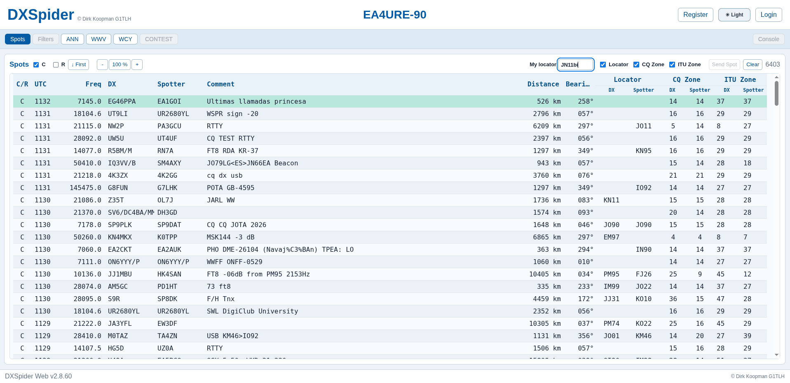

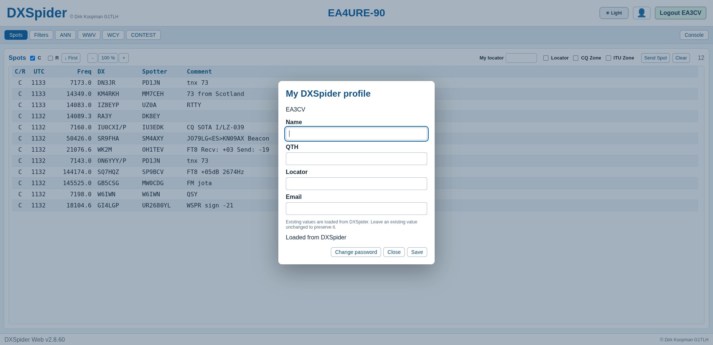

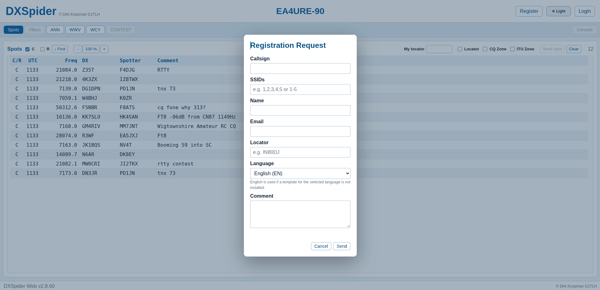

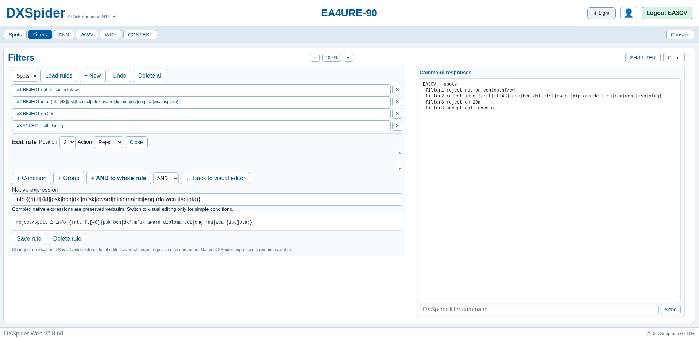

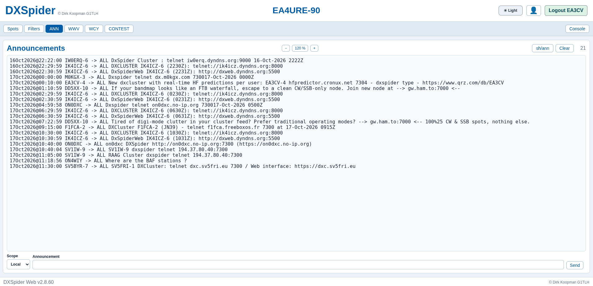

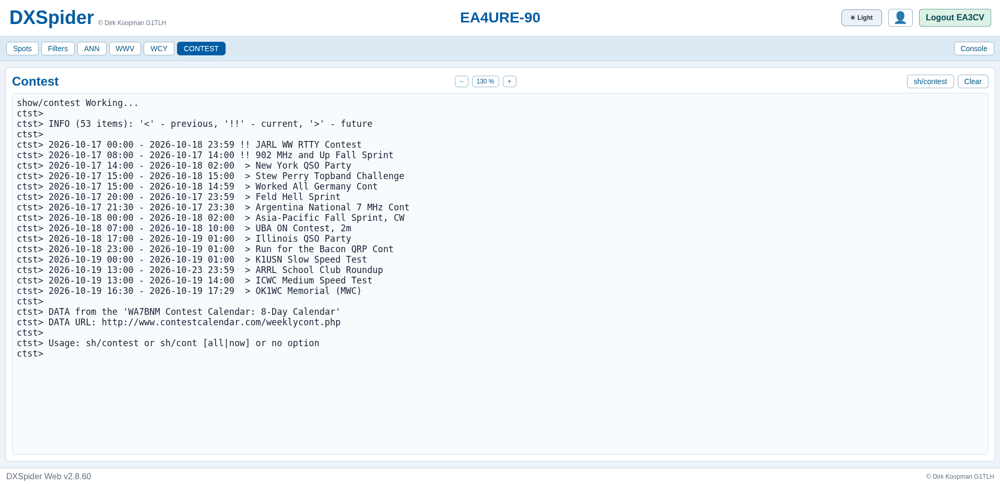

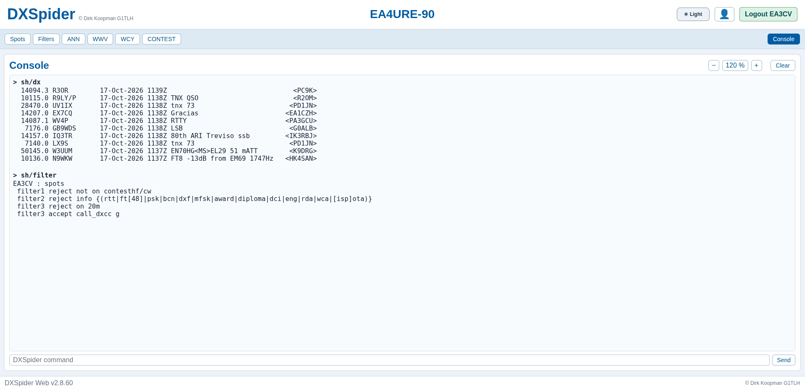

### DXWeb Admin

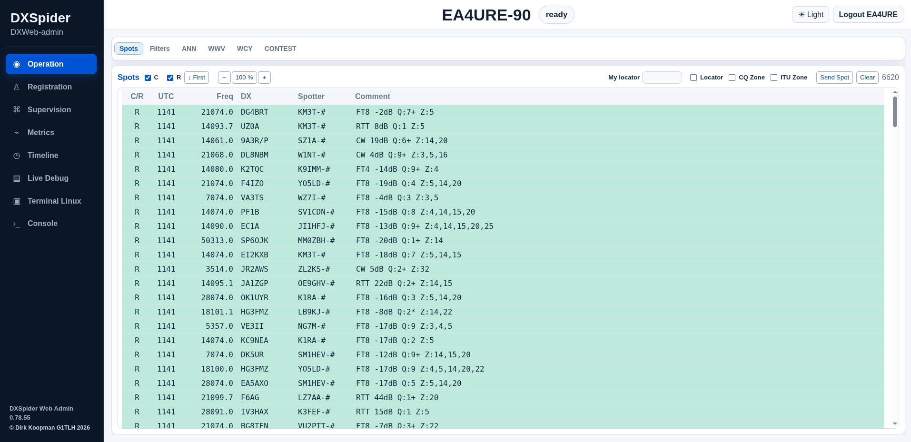

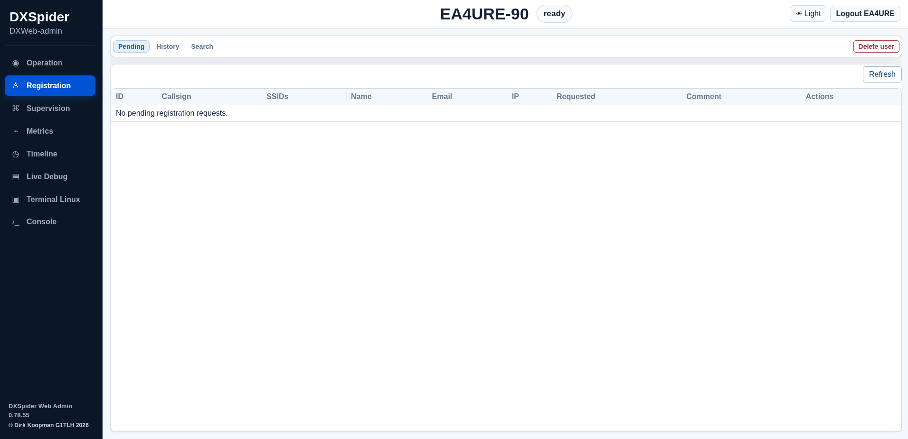

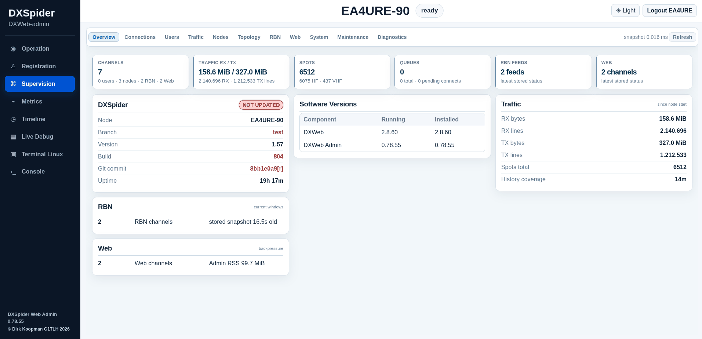

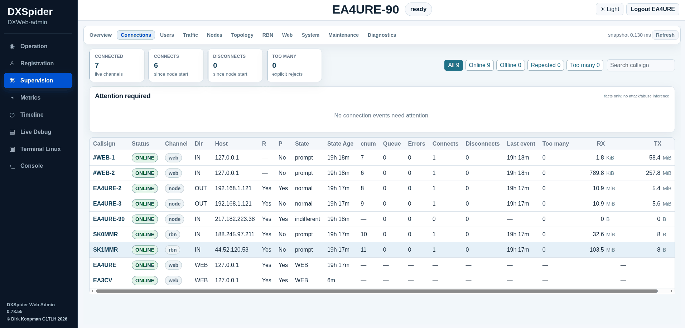

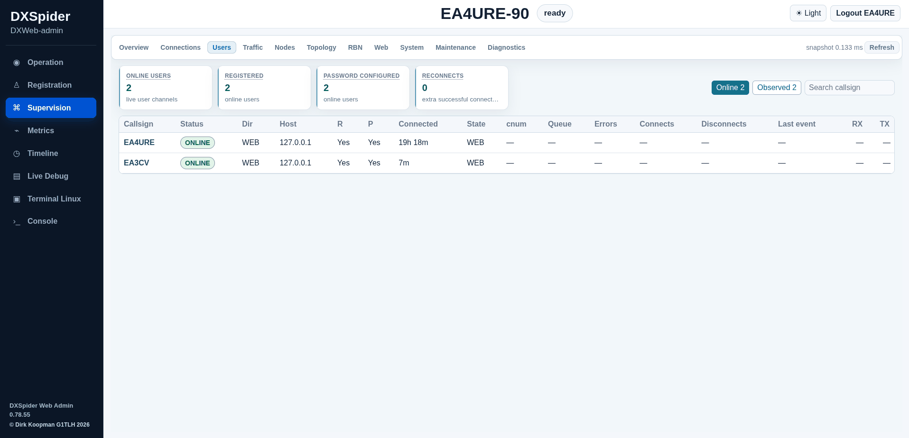

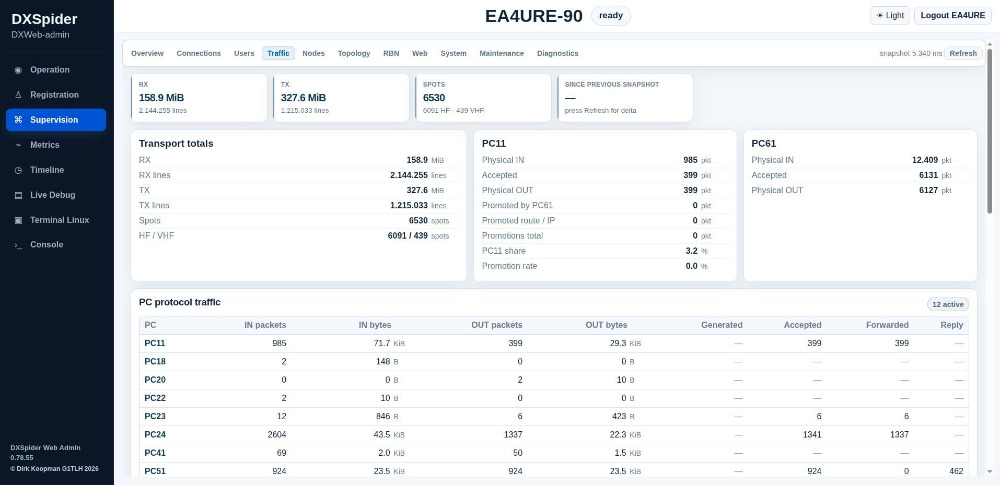

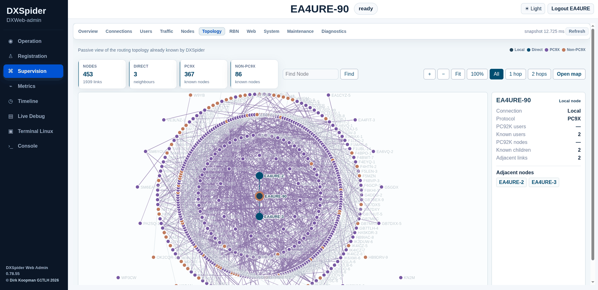

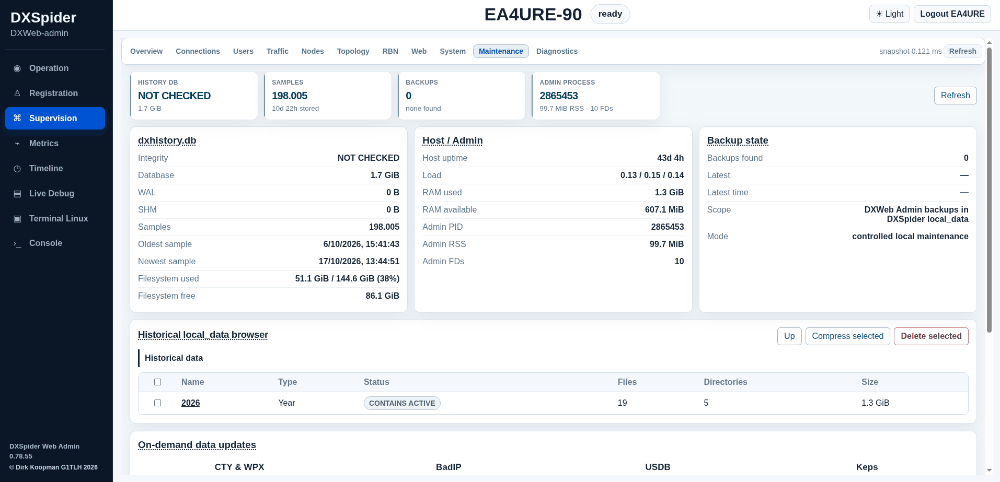

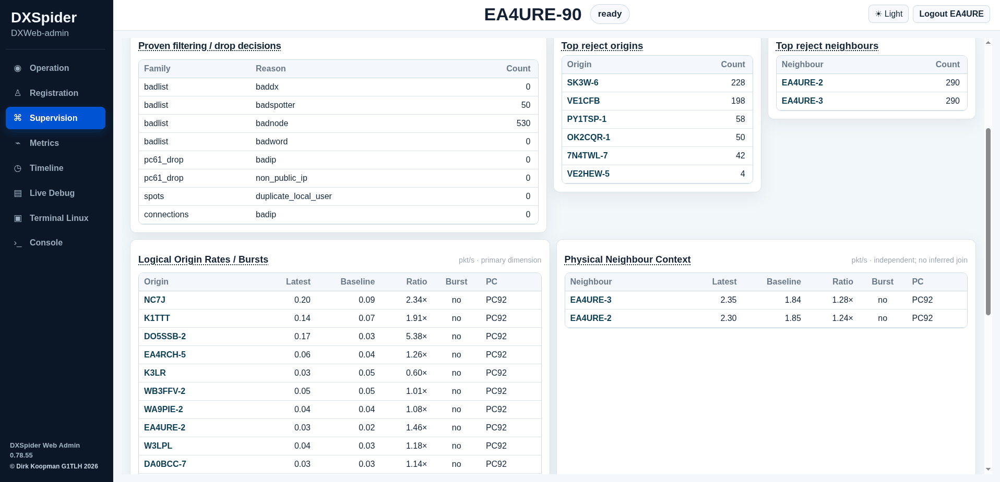

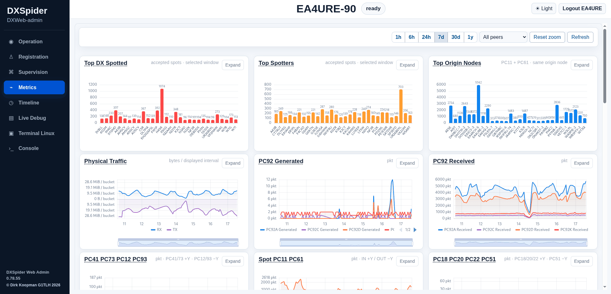

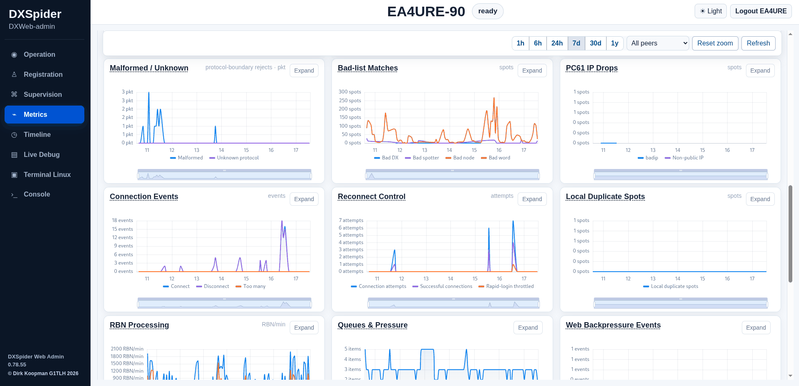

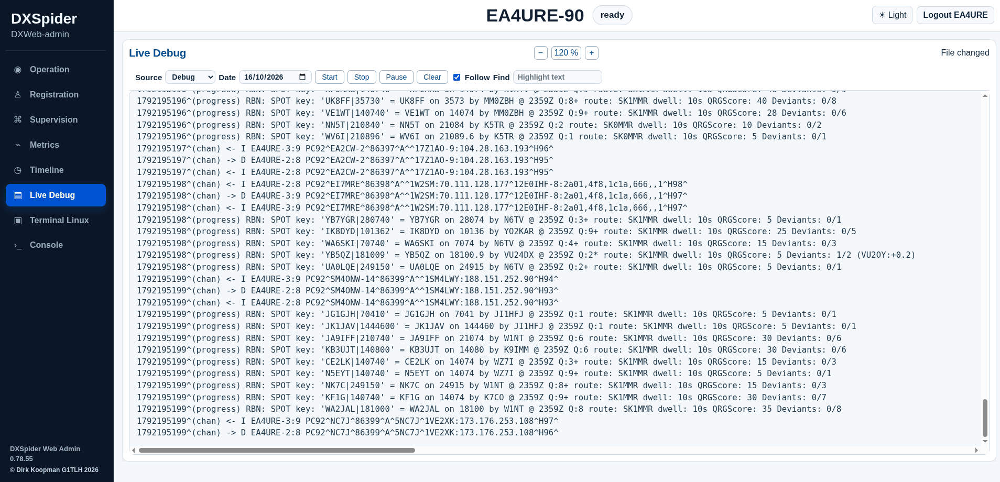

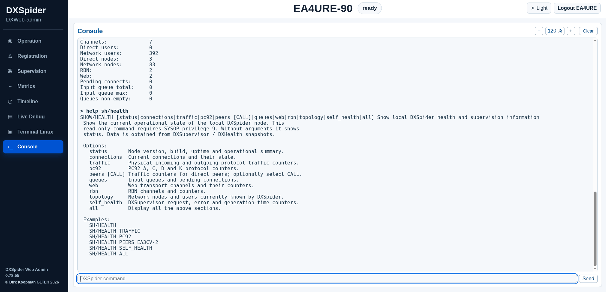

